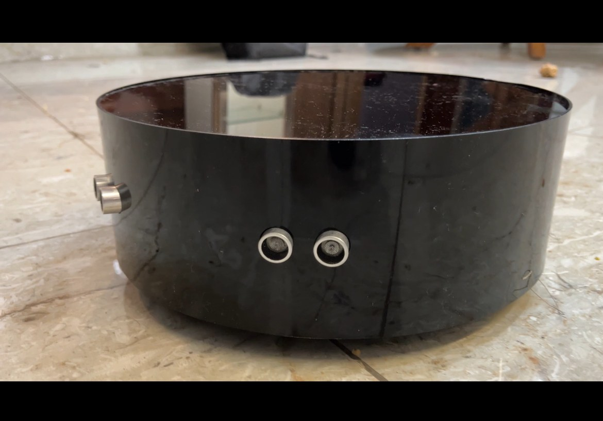
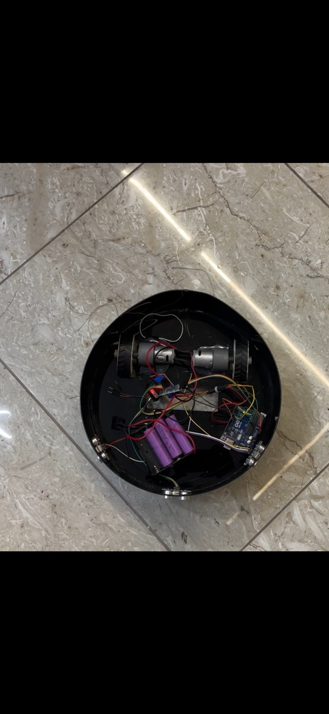
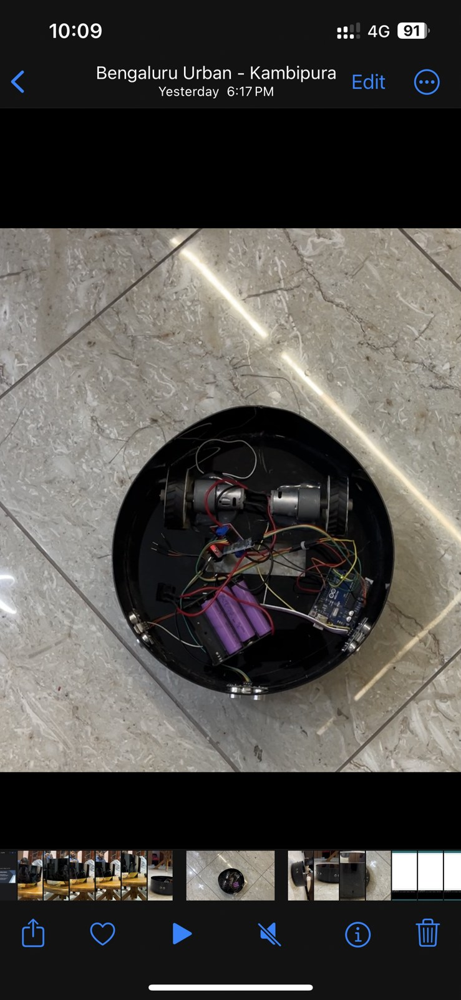

# Robotic Vacuum Cleaner Prototype

A compact floor-cleaning robot developed around an **Arduino Uno**, **HC-SR04 ultrasonic sensing** and **Adafruit motor control**. The build combines mobile movement with a motor-driven suction/pump mechanism inside a circular enclosure.

## Hardware and operation

The Arduino Uno provides control for the robot. Ultrasonic sensing supplies distance information, while Adafruit motor control is used for the movement and suction/pump motor arrangement. The project was programmed using Arduino.

| Item | Details |
| --- | --- |
| Controller | Arduino Uno |
| Distance sensing | HC-SR04 ultrasonic sensors |
| Motor control | Adafruit driver; shield revision and channel mapping need confirmation |
| Cleaning mechanism | Motor-driven suction/pump arrangement |
| Programming | Arduino |

## New reference firmware

A newly written implementation is available in [firmware/VacuumRobot](firmware/VacuumRobot). It assumes two DC drive motors, one front HC-SR04, and an optional suitably rated pump motor on a third driver channel. These are **reference wiring assumptions**, not a reconstruction of the original connections.

The firmware implements distance checks, short turning manoeuvres, a stop command, a retry limit when blocked, and stop-on-sensor-failure behavior. The pump operates only when configured and while the robot is moving forward. It supports selectable Adafruit V1 and V2 libraries.

This new firmware has not been tested on the physical robot. It does not establish cleaning efficiency, dust pickup or runtime results. Follow the [setup and validation guide](firmware/README.md) before uploading.

## Assembly views

## Earlier code references

The [original code screenshots](docs/code-screenshots) are retained separately. They show a serial-command program using direct motor-control pins, so the new Adafruit-based implementation is not presented as a copy of that program.
