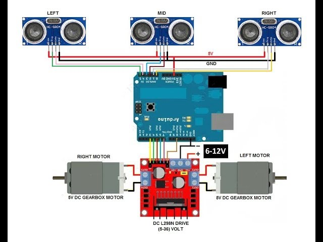

# Robotic Vacuum Cleaner Prototype

A compact floor-cleaning robot developed around an **Arduino Uno**, **HC-SR04 ultrasonic sensing** and an **L298 motor driver**. The build combines mobile movement with a motor-driven suction/pump mechanism inside a circular enclosure.

## My contribution — Semester 6

I worked on motor integration, coding and the electrical connections for the vacuum robot.

## Hardware and operation

The Arduino Uno provides control for the robot. Ultrasonic sensing supplies distance information, while an L298 driver is used for motor control; the separate 7 V pump connection is still to be confirmed. The project was programmed using Arduino.

| Item | Details |
| --- | --- |
| Controller | Arduino Uno |
| Distance sensing | Three HC-SR04 ultrasonic sensors |
| Motor control | L298; the supplied reference diagram shows an L298N module |
| Cleaning mechanism | 7 V suction/pump motor; current and driver connection unconfirmed |
| Programming | Arduino |

## New reference firmware

A newly written implementation is available in [firmware/VacuumRobot](firmware/VacuumRobot). It now uses direct L298 control and three ultrasonic sensors. The supplied circuit shows **two drive motors**, while the reported motor count was one. This code implements the two-wheel differential-drive arrangement from the drawing and must not be used on a one-drive-motor platform without adapting the steering logic.

The code stops for invalid sensor readings, checks clearance before moving, and uses short pivots toward the clearer side. Pump control is intentionally omitted until its separate driver and current rating are known. The previous Adafruit implementation has been replaced.

This firmware is newly written and has not been tested on the physical robot. Follow the [setup guide](firmware/README.md) before uploading.

## Circuit reference

The reference shows an Uno, three HC-SR04 sensors, an L298N and two geared drive motors. It does not show the suction pump circuit. The drawing's generic supply labels are not confirmed project battery specifications.

## Assembly views

## Earlier code references

The [original code screenshots](docs/code-screenshots) are retained separately. They show a serial-command program using direct motor-control pins, so the new three-sensor L298 implementation is not presented as a copy of that program.
